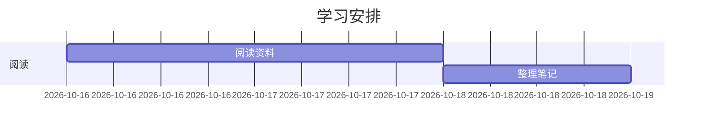
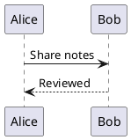

# 我的笔记

在这个空行按 `Space m c` 生成文内目录。保存后目录会随标题更新。

## 图片

复制截图后，按 `Space m v`，图片保存到本文档旁的 `imgs/`。
SSH 下按 `Space m V`，在本机预览页点击「粘贴图片」或按 Ctrl-v。

插入图片后，可用 `:VimMarkdownImageSize 60% center` 调整尺寸和居中。

## 输入与公式

在空行输入 `link` 或 `code`，按 Tab 展开并逐项填写，Shift-Tab 返回。
输入 `4x4tb` + Tab 可建立四列、四行正文的表格。

`mk` + Tab 插入行内公式，`dm` + Tab 插入独立公式。
在公式中试试 `ff`、`sqrt`、`sum`、`alpha` + Tab，以及直接输入 `A1`、`x/`。

$$
\sum_{i=1}^{n} \frac{x_i}{\sqrt{1+x_i^2}}
$$

## 图表

### Mermaid 流程图

### Mermaid 甘特图

### PlantUML

## 折叠与保存

`Space m z` 折叠当前章节，`Space m Z` 折叠全部。
`:VimMarkdownFold level 2` 展开到二级，`:VimMarkdownFold open` 全部展开。

状态栏随光标显示章节位置。Markdown 自动保存已启用，按 `Space m a` 切换当前文档。
